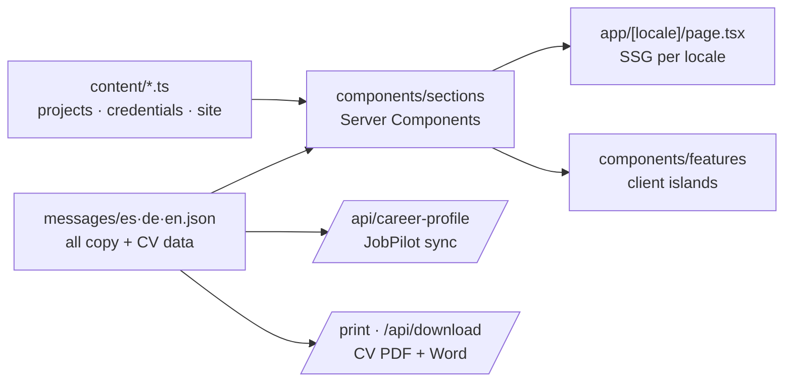

# Vidal Reñao — Professional Portfolio

[](https://nextjs.org)
[](https://www.typescriptlang.org)
[](https://tailwindcss.com)
[](https://next-intl.dev)
[](https://playwright.dev)
[](https://vidal-pro-portfolio.vercel.app)

**Live:** [vidal-pro-portfolio.vercel.app](https://vidal-pro-portfolio.vercel.app)

One-page portfolio (ES/DE/EN) for IT infrastructure and AI work in Switzerland. Every project,
certificate and figure on the page can be opened and checked — see
[`docs/portfolio-audit-2026-10.md`](docs/portfolio-audit-2026-10.md).

Lighthouse mobile (production build): Performance 92–93 · Accessibility 100 · Best practices 100.

---

## Architecture



```text
app/
├── [locale]/page.tsx        ← one page, sections in recruiter order (static per locale)
├── [locale]/layout.tsx      ← fonts (self-hosted Geist), metadata, JSON-LD
├── [locale]/print/          ← printable CV (PDF via browser print)
└── api/
    ├── contact/             ← Zod · honeypot · 3 req/h per IP · SMTP
    ├── download/            ← CV as .docx
    └── career-profile/      ← CV JSON for JobPilot AI (contract: do not change shape)
content/                     ← typed data, single source of truth (no copy)
├── projects.ts
├── credentials.ts
└── site.ts                  ← contact data, section order
components/
├── layout/                  ← SiteHeader (active section, mobile sheet), SiteFooter
├── sections/                ← one Server Component per section
├── features/projects/       ← ProjectExplorer: search + category/stack filters
├── features/contact/        ← ContactForm, CopyEmail, CvDownload
└── ui/                      ← Section, Chip, inline SVG icons
lib/                         ← CV builders (docx, e-mail variants), career-profile builder
messages/                    ← es/de/en copy
tests/e2e/                   ← Playwright, desktop + Pixel 7
```

Only the header, project explorer and contact widgets ship JavaScript to the browser.

## How to add content

**A project** — add an entry to `content/projects.ts` (`slug`, `categories`, `status`, `stack`,
`url`, `repo` or `null` if private, optional `image` in `public/screenshots/`), then
`projects.items.<slug>` = `{ title, summary, highlights[3] }` in the three message files.
Only add projects whose URL works for an anonymous visitor.

**A certificate** — put the PDF in `public/assets/certs/`, add `{ key, group, pdf }` to
`content/credentials.ts`, and `certifications.<key>_title` / `_issuer` (plus the other keys used
by existing entries) in the three message files. `pdf: null` shows "available on request".

The e2e suite checks that every project has a safe outbound link and every certificate PDF exists.

## Routes

| Route | Purpose |
|---|---|
| `/es` · `/de` · `/en` | Portfolio |
| `/[locale]/print?variant=..&email=..` | Printable CV |
| `/api/download?format=word&locale=..&email=..` | CV `.docx` |
| `/api/career-profile` | CV JSON (schema v1) consumed by JobPilot AI; CDN cache 5 min, ETag |
| `POST /api/contact` | Contact form; returns 503 if SMTP is not configured (form shows the e-mail fallback) |

Legacy `/[locale]/consultation`, `/brand` and `/labs/*` redirect (308) to `/[locale]#contact`.

## Environment variables

Only the contact form needs configuration (`.env.example`):

| Variable | Description |
|---|---|
| `SMTP_HOST` / `SMTP_PORT` | SMTP server (465 SSL or 587 STARTTLS) |
| `SMTP_USER` / `SMTP_PASS` | SMTP credentials |
| `CONTACT_TO` | Recipient of contact messages |

## Commands

```bash
npm ci
npm run dev          # localhost:3000
npm run build        # production build
npm run lint && npm run typecheck
npm run test:e2e     # needs a build; starts `next start` on :3101
npm run audit        # production dependencies, high+ severity
```

Local runs can reuse an existing Chromium with `PW_CHROMIUM_PATH=/path/to/chrome`.

## CI

`.github/workflows/ci.yml` (Node 22): **quality** (lint + typecheck) · **build-and-test**
(build + Playwright desktop/mobile) · **security** (`npm audit` on production deps).
Vercel deploys `main`.

## Privacy

No analytics, trackers or external fonts. Contact messages are forwarded by e-mail only, never
stored. `/api/career-profile` contains no phone number or e-mail address.

## Profile content consistency

Academic qualifications are shared by the education section, printable CV and DOCX export through
`cvSystems.education` in all three locales. DAI was completed in 2011 (diploma issued in 2012);
ASIR was completed in 2014. Cisco course completion is described as training, not a professional
CCNA certification.

## JobPilot showcase (2026-10-28)

The English project card uses verified rule-based matching and EN/DE/ES document
claims. JobPilot links carry the portfolio locale (`/install?lang=en` from `/en`),
including its screenshot link. The public install screenshot replaces the Spanish
account screenshot so the showcase contains no personal application data.
